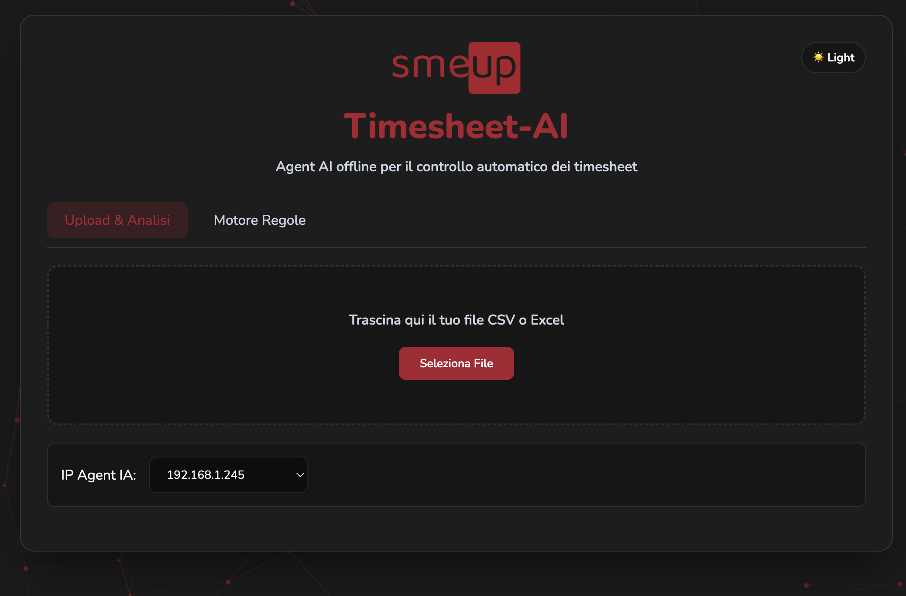
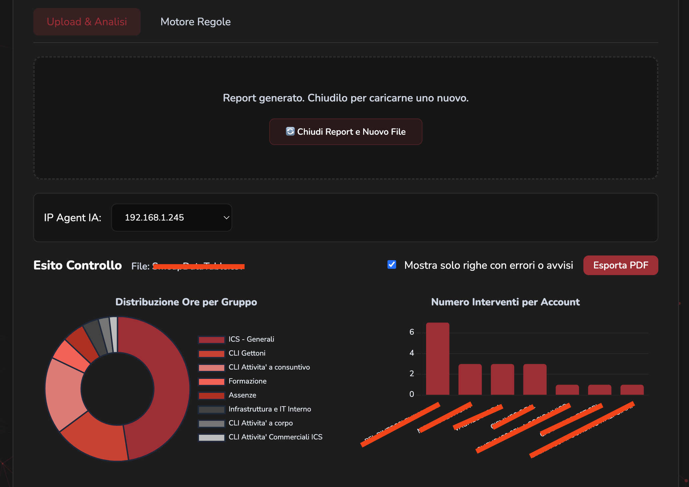
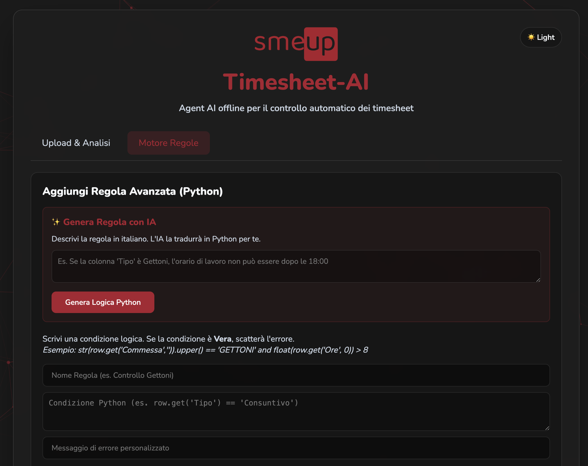

# Timesheet-AI 🔴

**Agent AI offline per il controllo automatico dei timesheet aziendali.**

Sviluppato per **Smeup** — Sistema basato su Google Gemma 4 (E2B) tramite Ollama, completamente locale e senza invio di dati all'esterno.

---

## 📸 Screenshots

| Upload & Analisi | Dashboard Risultati | Motore Regole |
|:---:|:---:|:---:|
|  |  |  |
| *Home page di caricamento* | *Risultati, Bande Rosse e Chart.js* | *Generatore regole con AI* |

---

## 🚀 NOVITÀ Versione 2.5: Modalità Team (Multi-Tecnico) & Confronto Ore
- **Riconoscimento Automatico Team:** Supporto nativo per timesheet cumulativi contenenti più tecnici o responsabili attività (`Responsabile Attività`, `Tecnico`, ecc.).
- **Filtro Avanzato Tecnico:** Barra selettore con visualizzazione aggregata (*Tutto il Team*) o filtrata per singolo membro del team con totale ore lavorate per ciascuno. Tutte le KPI card, grafici e righe si aggiornano istantaneamente al cambio di selezione.
- **Grafico a Barre Stacked di Confronto Team:** Nuovo grafico orizzontale che mette a confronto visivo immediato le ore fatturabili vs ore non fatturabili di ogni componente del team. Cliccando su una barra si filtra immediatamente la dashboard per quel tecnico.
- **Pulizia Intelligente Separatori ERP:** Filtro automatico delle righe di intestazione/banner (es. `Responsabile Attività - ...`, `Data Evasione - ...` ed esportazioni ERP senza ore/commesse), prevenendo falsi errori o distorsioni nei calcoli.
- **Risoluzione Codici Account:** Mappatura automatica della ragione sociale del cliente quando l'ERP esporta colonne duplicate (es. `Account` codice numerico e `Account.1` ragione sociale).
- **Filtro Membri nel Modal Non Fatturabile:** Selettore interno al popup per analizzare e copiare le note delle ore non fatturabili dell'intero team o di un singolo tecnico specifico.

---

## 🚀 NOVITÀ Versione 2.4: Monitoraggio Ore Non Fatturabili & Dettaglio Note
- **Tracking Ore Non Fatturabili:** Calcolo automatico e monitoraggio delle ore che non generano fatturato diretto, raggruppate per le categorie critiche:
  - `ICS Generali` (e varianti: `IC-GENERALI`, `IC Generali`)
  - `CLI Attività Commerciali` (e varianti commerciali)
  - `Formazione` (e corsi di formazione interna)
- **KPI Card Interattiva & Soglie di Allerta:** Nuova card KPI con percentuale sul totale ore lavorate e colorazione semaforica automatica (verde se 0%, arancione/ambra fino al 15%, rossa oltre il 15%).
- **Popup di Dettaglio con Note a Vista:** Cliccando sulla KPI card si apre un popup modale dedicato che elenca tutte le registrazioni non fatturabili con Data, Utente, Categoria (con badge colorati distinti), Account, Ore e la colonna completa di **Note / Descrizione**, con pulsante rapido per copiare il report negli appunti.
- **Filtro Rapido in Tabella & Evidenziazione:** Checkbox *"Mostra solo non fatturabili"* e riga evidenziata con badge ambra nella tabella principale dei dati.

---

## 🚀 NOVITÀ Versione 2.3: Rilevamento Giorni Mancanti & Popup Interattivi
- **Rilevamento Giorni Lavorativi Mancanti:** Il sistema rileva automaticamente se ci sono giorni feriali (lunedì-venerdì) privi di qualsiasi registrazione nel periodo caricato, iniettando una riga virtuale di errore rossa ordinata cronologicamente.
- **Popup di Dettaglio Interattivi:** Cliccando sulle fette del grafico a torta si apre un popup animato (effetto glassmorphism) che mostra l'elenco delle righe collegate, con auto-ridimensionamento e rimozione automatica delle colonne vuote (es. nei file monoutente).
- **KPI Cards & Context Switching:** Aggiunti indicatori per Ore Totali, Interventi Totali e **Context Switching Medio** (indice di frammentazione giornaliera del team, con esclusione di `IC-GENERALI` e colorazione dinamica).

---

## 🚀 NOVITÀ Versione 2.2: Transizione a Gemma 4
- **Modello IA di ultima generazione:** Aggiornato il modello locale a **Google Gemma 4 (E2B)** per migliori capacità di ragionamento logico, generazione di regole complesse e stabilità nell'interpretazione dei timesheet aziendali.
- **Rimozione Vecchio Modello:** Disattivato e rimosso Gemma 2 per liberare spazio sulla VM.

---

## 🚀 NOVITÀ Versione 2.1: Fix Export PDF
- **Export PDF Intelligente in Dark Mode:** Risolto un bug che rendeva i PDF illeggibili (testo bianco su sfondo bianco) quando si utilizzava il tema scuro o c'erano etichette chiare nei grafici. Il sistema ora converte i colori in automatico in background garantendo documenti perfetti e pronti per un'eventuale stampa.

---

## 🚀 NOVITÀ Versione 2.0: Dashboard Manageriale
L'applicazione non si limita più al controllo degli errori, ma offre statistiche in tempo reale:
- **Grafico a Torta (Gruppi):** Mostra la percentuale di ore impiegate per ogni *Gruppo Timesheet*.
- **Grafico a Barre (Clienti):** Mostra il numero di interventi totali per ogni *Account* o Cliente.
- **Supporto PDF:** La dashboard interattiva viene automaticamente stampata in prima pagina nell'export PDF!

---

## Funzionalità

- 📂 **Upload CSV/Excel** — Caricamento file con rilevamento automatico dell'encoding
- 🧠 **Motore Regole V2 (Cross-Row)** — Le regole possono aggregare dati su più righe (es. ore mensili)
- 🛡️ **Parser Intelligente** — La funzione `safe_float()` converte "3,5" in 3.5 e ignora celle vuote senza crash
- 🔴 **Bande di Errore** — Visualizzazione degli errori come bande rosse sopra le righe errate
- ✨ **Animazione Magica** — Animazione con stelle durante l'elaborazione AI
- 🤖 **Generatore Regole IA** — Descrivi la regola in italiano, l'AI genera il codice Python
- ⚡ **Toggle Regole** — Attiva/disattiva le regole senza eliminarle
- ✏️ **Editing Regole** — Modifica le regole esistenti al volo
- 🌗 **Dark/Light Mode** — Tema chiaro e scuro con memoria nel browser
- 📄 **Export PDF** — Genera un report PDF del controllo in un click
- 🌐 **IP Intelligente** — Ricorda l'ultimo IP dell'agente AI usato

---

## Stack Tecnologico

| Componente | Tecnologia |
|---|---|
| Backend | FastAPI (Python) |
| AI Engine | Google Gemma 4 (E2B) via Ollama |
| Database | SQLite |
| Frontend | HTML, CSS (Vanilla), JavaScript |
| Font | Nunito (Google Fonts) |
| Particelle | tsParticles |
| Export PDF | html2pdf.js |

---

## Requisiti Hardware & Software (Server/VM)

- **OS:** Linux (Ubuntu Server consigliato)
- **CPU:** Minimo 4 vCPU (8 vCPU consigliate per ridurre i tempi di inferenza dell'IA senza GPU dedicata)
- **RAM:** 8–12 GB consigliati
- **Disco:** ~20 GB di spazio libero (necessari per OS, librerie Python e pesi del modello LLM)
- **Rete:** IP statico per la VM e Reverse Proxy opzionale sulla porta 8000
- **Software:** Python 3.10+ e [Ollama](https://ollama.com/) installato con il modello `gemma4:e2b`

---

## Installazione

```bash
# Clona il repository
git clone https://github.com/mantovanellimatteo/timesheet-ai.git
cd timesheet-ai

# Crea e attiva l'ambiente virtuale
python3 -m venv venv
source venv/bin/activate  # Su Windows: venv\Scripts\activate

# Installa le dipendenze
pip install fastapi uvicorn pandas openpyxl requests python-multipart

# Avvia il server
uvicorn main:app --host 0.0.0.0 --port 8000 --reload
```

Apri il browser su `http://localhost:8000`

---

## Configurazione Ollama

```bash
# Installa Ollama (Linux)
curl -fsSL https://ollama.com/install.sh | sh

# Scarica il modello Gemma 4
ollama pull gemma4:e2b

# Avvia il server Ollama
ollama serve
```

---

## Struttura del Progetto

```
timesheet-ai/
├── main.py              # Backend FastAPI
├── static/
│   ├── index.html       # Interfaccia utente
│   ├── styles.css       # Stili (tema Smeup)
│   ├── script.js        # Logica frontend
│   └── logo.png         # Logo aziendale
└── README.md
```

---

## Come usare il Motore Regole V2

Le regole si basano su espressioni Python. Hai a disposizione:
- `row`: la singola riga analizzata (Dizionario)
- `rows`: tutte le righe del documento (Lista di Dizionari, utile per il cross-row)
- `safe_float(val)`: funzione per convertire numeri con la virgola (2,5) ed evitare crash su celle vuote.

**Esempio 1 — Singola Riga (Gettoni errati):**
```python
str(row.get('Gruppo Timesheet', '')).strip().upper() == 'CLI GETTONI' and safe_float(row.get('Ore')) % 0.25 != 0
```

**Esempio 2 — Regola Multi-Riga (Somma giornaliera):**
Se le ore totali di una persona in un giorno superano le 8 ore:
```python
sum(safe_float(r.get('Ore')) for r in rows if r.get('Data', '') == row.get('Data', '') and r.get('Utente', '') == row.get('Utente', '')) > 8
```

Oppure usa il **Generatore IA** integrato: descrivi la regola in italiano (anche complessa e multi-riga) e Gemma 4 scriverà il codice Python per te!

---

## 📊 Metrica del Context Switching (CS)

Il **Context Switching Medio** è un indicatore sintetico introdotto nella dashboard (KPI Cards) per monitorare il **livello di frammentazione del lavoro** e la dispersione delle risorse nel team.

### Concetto e Raggruppamento
L'indice valuta quanto ciascun collaboratore è costretto a saltare tra commesse/clienti differenti durante la stessa giornata lavorativa.

1. **Raggruppamento Giornaliero**: i dati vengono aggregati per coppia `Utente` + `Data`.
2. **Esclusioni**:
   - Vengono escluse dal calcolo le registrazioni del gruppo **`IC-GENERALI`** (attività interne aziendali che non costituiscono un cambio di contesto cliente).
   - Vengono ignorate righe senza utente o data valida.

### Formula di Calcolo

Per ogni giornata lavorativa di ciascun collaboratore:
- $\text{Ore}_{\text{totali}}$ = somma delle ore lavorate nel giorno (al netto di `IC-GENERALI`).
- $\text{Ore}_{\max}$ = ore dedicate al cliente/commessa su cui l'utente ha speso più tempo nel giorno.

Il **Context Switching giornaliero** è calcolato come:

$$CS_{\text{giorno}} = 1 - \frac{\text{Ore}_{\max}}{\text{Ore}_{\text{totali}}}$$

Il **Context Switching Medio** mostrato nella KPI Card è la media aritmetica di tutte le giornate analizzate:

$$\text{CS Medio} = \frac{\sum CS_{\text{giorno}}}{N_{\text{giornate}}} \times 100\%$$

### Esempi Pratici

* **0% (Focus Totale)**: 8 ore lavorate sullo stesso cliente $\to 1 - \frac{8}{8} = 0\%$.
* **25% (Lieve Frammentazione)**: 6 ore sul Cliente A e 2 ore sul Cliente B $\to 1 - \frac{6}{8} = 25\%$.
* **75% (Forte Frammentazione)**: 2 ore ciascuno su 4 clienti diversi (totale 8 ore) $\to 1 - \frac{2}{8} = 75\%$.

### Soglie di Attenzione (Colori KPI)

| Soglia | Colore | Interpretazione |
| :---: | :---: | :--- |
| **$\le 50\%$** | 🟢 Verde | **Ottimale**: Lavoro ben focalizzato, tempo speso prevalentemente su un'attività principale. |
| **$51\% - 70\%$** | 🟡 Ambra | **Attenzione**: Frammentazione moderata tra più commesse. |
| **$> 70\%$** | 🔴 Rosso | **Critico**: Forte dispersione ed eccessivo cambio di contesto. |

---

## Licenza

Uso interno aziendale — Smeup SpA

---
*Sviluppato da Matteo Mantovanelli con Google Antigravity*
